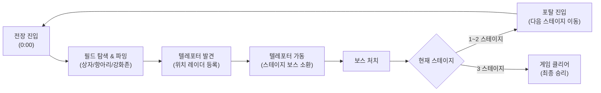
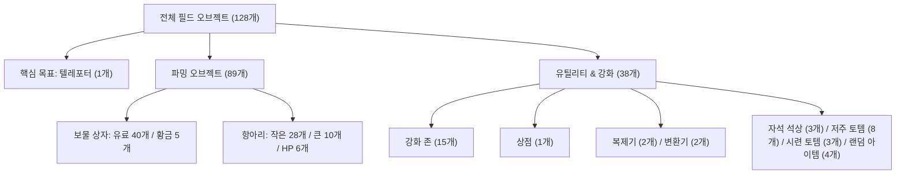
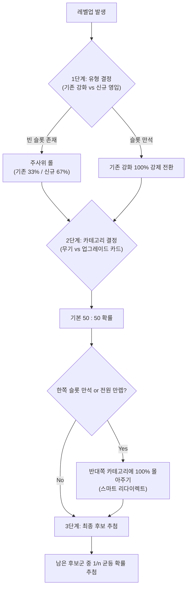
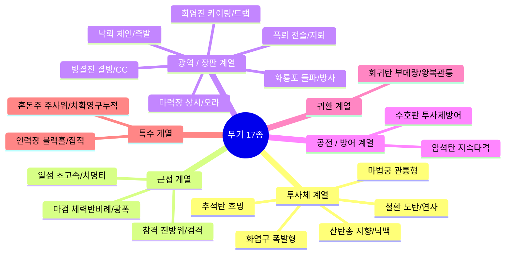

# 🎮 미니봉크(Minibonk) 게임 기획 명세서 (Game Design Document)

본 문서는 **2.5D 탑다운 로그라이크 / 뱀서라이크 게임**의 핵심 아키텍처, 게임 루프, 시스템 규칙 및 각종 개념을 체계적으로 정리한 마크다운 기획서입니다.  
아이템, 스탯, 무기 등의 방대한 세부 수치 데이터는 가독성을 위해 별도의 데이터베이스 문서로 분리되어 있으며, 각 섹션의 앵커 링크를 통해 즉시 열람할 수 있습니다.

---

## 📑 목차
1. [게임 개요 및 핵심 루프](#1-게임-개요-및-핵심-루프)
2. [맵 & 필드 오브젝트 시스템](#2-맵--필드-오브젝트-시스템)
3. [인벤토리 및 슬롯 시스템](#3-인벤토리-및-슬롯-시스템)
4. [확률 및 행운(Luck) 시스템](#4-확률-및-행운luck-시스템)
5. [스탯 시스템 메커니즘](#5-스탯-시스템-메커니즘)
6. [무기 시스템 구조](#6-무기-시스템-구조)
7. [아이템 시스템 구조](#7-아이템-시스템-구조)
8. [경제 및 성장 곡선](#8-경제-및-성장-곡선)
9. [세부 데이터베이스 바로가기](#9-세부-데이터베이스-바로가기)

---

## 1. 게임 개요 및 핵심 루프

### 1.1 기본 정보
- **장르**: 뱀서라이크 (Survivors-like) + 로그라이크 (Roguelike)
- **시점 / 그래픽**: 2.5D 탑다운 뷰 (플레이어 크기 약 1.0 유닛)
- **플레이어 캐릭터**: 기본 1종 (확장 가능한 구조)
- **게임오버 조건**: 플레이어 체력이 0에 도달했을 때 (타이머 제한 없음)
- **최종 승리 조건**: 3스테이지 보스 처치

### 1.2 핵심 게임 루프
단순 시간 버티기 방식이 아닌, **'능동적 필드 탐색과 포탈 개척'**을 결합한 3단계 순환 구조입니다.

### 1.3 스테이지 구조 및 진행
- **스테이지 구성**: 총 3개의 스테이지로 구성되며, 스테이지를 넘어갈 때마다 새로운 절차적 맵이 생성됩니다.
- **웨이브 및 엘리트 스폰 규칙**:
  - 엘리트 몬스터는 전 스테이지 공통으로 **전체 스폰의 8%** 비율을 차지합니다.
  - 다음 스테이지로 넘어갈수록 엘리트 몬스터 자체의 기초 체급(체력, 공격력)이 대폭 상승합니다.

### 1.4 타이머 기반 필드 이벤트 테이블
각 스테이지는 입장 시간(0:00)부터 진행 시간에 따라 플레이어를 압박하는 위기 이벤트가 발생합니다.

| 경과 시간 | 발생 이벤트 | 세부 내용 및 드롭 보상 |
| :---: | :--- | :--- |
| **0:00** | **스테이지 입장** | 타이머 시작, 몬스터 기본 스폰 개시 |
| **3:00** | **중간보스 1 소환** | 플레이어 근처에 기습 소환. 처치 시 [보상 보물상자](#필드-오브젝트-세부-개념) **100% 확정 드롭** |
| **4:00** | **몬스터 웨이브 1** | 30초 동안 몬스터 스폰량이 평상시의 **3배**로 급증 (대량의 골드/EXP 기회) |
| **7:00** | **몬스터 웨이브 2** | 30초 동안 몬스터 스폰량이 평상시의 **3배**로 급증 |
| **8:00** | **중간보스 2 소환** | 플레이어 근처에 2차 중간보스 소환. 처치 시 보상 상자 **100% 확정 드롭** |
| **10:00** | **벌떼(Swarm) 출현** | 경고 연출과 함께 기존 몬스터와 외형이 완전히 다른 특수 살인 벌떼 스폰 시작 |
| **11:00** | **벌떼 1단계 강화** | 벌떼 스펙 상향 |
| **16:00** | **벌떼 2단계 강화** | 벌떼 스펙 추가 상향 |
| **22:00** | **벌떼 3단계 강화** | 벌떼 스펙 극한 상향 |
| **22:00+** | **한계 돌파 (소멸 구간)** | 매 분마다 벌떼가 지속 강화되어 사실상 생존 불가. (빠른 보스전 유도 장치) |

> 💡 **설계 의도**: 벌떼 시스템은 플레이어가 파밍에만 안주하지 않고 적절한 시점에 텔레포터를 작동시켜 다음 단계로 넘어가도록 강제하는 소프트 타임어택 기믹입니다.

---

## 2. 맵 & 필드 오브젝트 시스템

### 2.1 맵 기본 규격
- **크기**: $240 \times 240$ 유닛 (플레이어 크기 1유닛 기준)
- **형태**: 경계가 존재하는 유한 맵 (끝에서 끝 직선 주파 시 약 50초 ~ 1분 소요)
- **오브젝트 배치 원칙**: 오브젝트 간 최소 거리를 유지하는 분산 알고리즘을 적용하여 뭉침 현상을 방지합니다.
- **1회용 원칙**: 필드의 모든 오브젝트는 1회 상호작용 후 비활성화되며, 항아리는 파괴 시 소멸합니다.

### 2.2 고정 배치 오브젝트 구성 (총 128개)
매 스테이지마다 아래의 128개 오브젝트가 맵 전체에 무작위로 분산 배치됩니다.

### 2.3 필드 오브젝트 세부 개념

1. **텔레포터 (Teleporter - 1개)**
   - **스폰 위치**: 맵 외곽 15%를 제외한 중심 85% 영역 내 무작위 스폰.
   - **감지 및 레이더**: 플레이어가 시야 내에서 한 번이라도 감지하면, 이후 화면 가장자리에 **방향 안내 화살표(Radar Arrow)**가 영구 표시됩니다.
   - **동작**: 접근 후 상호작용 시 타이머나 킬수와 무관하게 스테이지 보스가 즉시 소환됩니다. 보스 처치 후 포탈로 변환되며, 재상호작용 시 다음 스테이지로 워프합니다.
2. **강화 존 (Enhancement Zone - 15개)**
   - 범위 내에 진입하여 일정 시간 버티면 무작위 스탯 3개 중 1개를 선택하여 영구 강화합니다.
   - **금색 강화 존 (Golden Zone)**: 10% 확률로 일반 강화 존 대신 등장하며, 레전더리 등급 선택지 확률이 대폭 증가합니다.
   - 세부 수치는 [스탯 세부 증가량 테이블](data_stats_values.md#2-스탯별-세부-증가량-테이블-카드-vs-강화-존)을 참조하십시오.
3. **보물 상자 (Chests)**
   - **유료 상자 (40개)**: 골드를 지불하여 무작위 아이템을 획득합니다. 상자를 열 때마다 비용이 지수 함수로 증가합니다. ([회차별 상자 비용표 바로가기](data_tables_economy.md#1-보물-상자-누적-비용표-133회차))
   - **황금 상자 (5개)**: 비용 없이 무료로 아이템을 즉시 획득할 수 있는 희귀 상자입니다.
   - **보상 보물 상자 (조건부 드롭)**: 엘리트 처치(30%), 중간보스 처치(100%), 벌떼 처치(0.006%), 시련 토템 완수(100%) 시 바닥에 무료 아이템 상자로 생성됩니다.
4. **항아리 (Jars - 44개)**
   - 공격으로 파괴 가능하며, 골드와 경험치 보상이 50:50 비율로 배분됩니다.
   - **핑크 동전 (Pink Coin)**: 작은 항아리 10%, 큰 항아리 20% 확률로 일반 골드의 5~10배 가치를 지닌 핑크 동전이 추가 드롭됩니다.
   - 세부 드롭 수치는 [항아리 드롭 수치표](data_tables_economy.md#5-몬스터-및-항아리-드롭-수치표)를 참조하십시오.
5. **상점 (Shop - 1개)**
   - 아이템 구매, 무기/카드 슬롯 개폐 관리, 아이템 1회 매각이 가능합니다.
   - 판매 가격은 누적 플레이 시간에 비례해 상승합니다. ([상점 시간대별 가격표](data_tables_economy.md#2-상점-아이템-가격-스케일링-플레이-누적-시간-기준))
6. **복제기 & 변환기 (Duplicator & Converter - 각 2개)**
   - **복제기**: 골드를 지불하여 보유 중인 아이템 중 하나와 동일한 아이템을 복제 획득합니다.
   - **변환기**: 골드를 지불하여 보유 아이템 1개를 상위 1단계 등급의 무작위 아이템으로 변환합니다.
7. **토템 및 석상**
   - **자석 석상 (3개)**: 상호작용 시 필드 전역에 흩어진 모든 미회수 경험치 보석을 즉시 플레이어에게 끌어당깁니다.
   - **저주 토템 (8개)**: 상호작용 시 해당 판 전체 난이도가 +5% 상승합니다.
   - **시련 토템 (3개)**: 상호작용 시 엘리트 몬스터 무리를 대량 소환하며, 모두 처치 시 보상 상자를 지급합니다.

---

## 3. 인벤토리 및 슬롯 시스템

### 3.1 시작 시 슬롯 설정 (Slot Customization)
플레이어는 게임 시작 무기 선택 창에서 이번 런에 사용할 슬롯 개수를 직접 설정합니다.
- **선택 범위**: 무기 슬롯 1~4개, 카드 슬롯 1~4개
- **자동 잠금 (Auto-Lock)**: 유저가 선택한 개수만큼만 활성화되고, 나머지는 잠금 처리되어 드롭 풀에서 배제됩니다.
  - **1~2 슬롯 (초압축 빌드)**: 특정 핵심 무기와 카드를 초고속으로 집중 육성.
  - **3~4 슬롯 (표준 시너지 빌드)**: 다양한 공격과 패시브의 연쇄 조합을 노림.

### 3.2 레벨업 3단계 가중치 로직
플레이어가 레벨업을 달성하여 3개의 선택지가 제시될 때 내부 필터 알고리즘입니다.

### 3.3 성장 종료 및 만렙 규칙 (Max Level)
- **무기 최대 레벨**: **40 레벨**
- **업그레이드 카드 최대 레벨**: **99 레벨**
- 만렙에 도달한 아이템은 선택지 후보군에서 영구 제외됩니다.
- 장착한 모든 슬롯이 만렙에 도달하면 더 이상 레벨업 선택창이 뜨지 않고 게임 종료까지 전투에 집중합니다.

### 3.4 신규 획득 등급 배율
새로운 무기나 카드를 Lv 1로 최초 영입할 때도 [행운 등급 판정](#4-확률-및-행운luck-시스템)이 발동합니다.  
에픽(1.6x) 또는 레전더리(2.0x) 등급으로 최초 획득할 경우, **1레벨임에도 불구하고 기본 공격력/수치가 해당 배율만큼 뻥튀기된 상태**로 장착됩니다.

---

## 4. 확률 및 행운(Luck) 시스템

### 4.1 행운(Luck)의 정의
행운은 카드, 강화 존, 아이템에서 획득한 모든 행운(%)을 **단순 합산**하여 산출되는 통합 수치입니다.  
행운은 레벨업 선택지 및 필드 보상에서 고등급이 당첨될 확률을 직접 보정합니다.

### 4.2 등급 가중치 및 최종 무게 계산
각 등급은 고유한 기초 무게($W_0$), 효율 계수($E$), 강화 배율을 갖습니다.

$$\text{최종 무게}(W) = W_0 \times \left(1 + \frac{\text{총 행운}}{100} \times E\right)$$

| 등급 (Rarity) | 기초 무게 ($W_0$) | 효율 계수 ($E$) | 강화 배율 (Mult) | 특성 및 포지션 |
| :--- | :---: | :---: | :---: | :--- |
| **커먼 (Common)** | 650.0 | **0.0** | 1.0x | 행운 스탯의 영향을 일절 받지 않음 |
| **언커먼 (Uncommon)** | 200.0 | **0.1** | 1.2x | 완만하고 안정적인 증가 |
| **레어 (Rare)** | 100.0 | **0.3** | 1.4x | 중반 체감 화력 상승 |
| **에픽 (Epic)** | 40.0 | **1.0** | 1.6x | 고점 투자에 대한 확실한 보상 |
| **레전더리 (Legendary)** | 10.0 | **15.0** | 2.0x | 효율 계수가 압도적으로 높아 행운 빌드의 핵심 잭팟 |

> 행운 수치 변화에 따른 구체적인 출현 확률 변동표는 [행운 시뮬레이션 데이터](data_stats_values.md#5-행운에-따른-등급별-확률-시뮬레이션)를 참조하십시오.

### 4.3 동시 강화 스탯 개수 판정 (무기)
등급이 결정되면, 행운과 무관하게 해당 등급의 고유 확률에 따라 몇 개의 스탯을 동시에 올릴지 결정합니다.
- **커먼**: 1개(60%) / 2개(35%) / 3개(5%)
- **에픽**: 1개(5%) / 2개(35%) / 3개(60%)
- **레전더리**: 1개(0%) / 2개(10%) / **3개(90%)**

### 4.4 최종 강화 연산 프로세스
1. **등급 & 개수 판정**: 행운으로 등급 결정 $\rightarrow$ 등급에 따른 강화 스탯 개수($k$) 결정
2. **대상 스탯 무작위 추출**: 무기의 전체 스탯 중 중복 없이 $k$개 무작위 선정
3. **수치 적용**: `기본 강화량 × 등급 배율`을 현재 무기 스탯에 가산
4. *(특수)* **혼돈의 카드**: 무작위 스탯을 뽑은 뒤 결과값에 **추가 1.5배(+50%)** 보너스를 부여합니다. ([혼돈의 카드 계산식 확인](data_stats_values.md#4-혼돈의-카드-수치-계산-예시))

---

## 5. 스탯 시스템 메커니즘

스탯 시스템은 단순 합산뿐만 아니라 곱연산, 점감형(Diminishing Returns), 오버크리티컬 등 정밀한 수학적 모델을 사용합니다.  
각 스탯의 기본값 및 계산식 전체는 [스탯 기본 규격 및 공식 테이블](data_stats_values.md#1-스탯-기본-규격-및-계산-공식)을 확인하십시오.

### 5.1 연산 구조에 따른 스탯 분류
- **합연산 그룹**: 최대 체력, HP 회복, 공격 속도, 이동 속도, 픽업 범위, 행운, 경험치/골드 증가량, 난이도.
- **곱연산 그룹**: 대미지, 치명타 대미지, 투사체 속도, 지속 시간, 공격 크기, 넉백.
  - 플레이어의 체급이 커질수록 시너지가 기하급수적으로 폭발하도록 설계되었습니다.

### 5.2 점감형 방어 스탯 (무적 방지)
플레이어가 특정 수치를 무한히 쌓아 100% 무적이 되는 현상을 원천 방지하기 위해 점감형 공식을 사용합니다.
- **방어력 공식**:
  $$\text{피해 감소율(\%)} = \frac{n}{0.75 + n} \times 100\% \quad (n = 0.01 \times \text{누적 합산치})$$
- **회피율 공식**:
  $$\text{회피 확률(\%)} = \frac{n}{1.0 + n} \times 100\% \quad (n = 0.01 \times \text{누적 합산치})$$
  - *회피 판정 주의*: 회피 성공 시 데미지를 0으로 무효화하며, **피격 판정이 아니므로** 피격 시 발동 아이템이나 가시(Thorns)는 작동하지 않습니다.

### 5.3 오버크리티컬 (Overcritical) 메커니즘
치명타 확률이 100%를 초과할 경우, 초과분은 버려지지 않고 상위 단계의 폭발적인 배율로 승격됩니다.
- 치명타 확률 $C$에 대해 $n = \lfloor C / 100 \rfloor$ 단계의 배율은 확정 발동.
- 나머지 $C \pmod{100}$% 확률로 $n+1$ 단계 배율 발동.
- 3단계($n=3$)부터 특수 2차 방정식 기반 초고배율(4.0x, 6.25x, 9.0x...)이 가동됩니다.  
  자세한 단계별 배율 수치는 [오버크리티컬 배율표](data_stats_values.md#3-오버크리티컬-배율표)를 참조하십시오.

### 5.4 소수점 확률형 스탯
- **투사체 수 (Amount)**: 누적 수치의 정수부는 확정 발사, 소수부는 추가 1발 추가 발사 확률로 계산.
- **생명 흡수 (Lifesteal)**: 100%당 1의 체력 확정 흡수, 100% 미만 소수부는 추가 회복 확률로 판정.

---

## 6. 무기 시스템 구조

플레이어 주변에서 자동으로 적을 공격하는 주 화력 수단입니다. 총 17종이 존재하며 6개 계열로 구분됩니다.  
각 무기별 상세 수치는 [무기 세부 스펙 데이터](data_weapons.md#무기-계열-요약-및-성장-규칙)를 참조하십시오.

- **투사체 계열**: [화염구, 마법궁, 철환, 추적탄, 산탄총](data_weapons.md#2-투사체-계열-5종)
- **근접 계열**: [참격, 일섬, 마검](data_weapons.md#3-근접-계열-3종)
- **광역/장판 계열**: [화염진, 낙뢰, 마력장, 빙결진, 화룡포, 폭뢰](data_weapons.md#4-광역--장판-계열-6종)
- **공전/방어 계열**: [암석탄, 수호판](data_weapons.md#5-공전--방어-계열-2종)
- **귀환 계열**: [회귀탄](data_weapons.md#6-귀환-계열-1종)
- **특수 계열**: [인력장, 혼돈주](data_weapons.md#7-특수-계열-2종)

---

## 7. 아이템 시스템 구조

필드 상자, 상점, 토템, 몬스터 보상 등에서 획득하는 패시브 장비입니다. 총 58종이 존재합니다.  
아이템 전체 목록과 스펙은 [아이템 세부 데이터 사전](data_items.md#아이템-세부-데이터-및-수치-사전-items-database)을 참조하십시오.

### 7.1 빌드 아키타입 (6대 빌드 태그)
1. **탱커 (Tanker - 11종)**: 최대 체력, 방어력, 가시(Thorns), HP 회복, 순간 체력 폭발.
2. **데미지 (Damage - 8종)**: 깡 대미지, 치명타 확률/데미지, 처치 시 영구 스탯 누적, 처형.
3. **이속/회피 (Agility - 8종)**: 이동 속도, 회피율, 회피 성공 시 무적 및 데미지 버프, 공속 연계.
4. **골드 (Gold - 5종)**: 골드 수급량, 상자 오픈 시 보너스 스탯 누적, 보유 골드 비례 딜링.
5. **리스크 (Risk - 6종)**: 최대 체력 페널티, 난이도 강제 상승을 대가로 막대한 공격력 확보.
6. **범용 (General - 20종)**: 투사체 수, 크기, 공속, 습득 범위 등 모든 빌드에 범용 적용.

### 7.2 아이템 중첩(Stacking) 메커니즘
동일 아이템을 다수 획득했을 때 다음 4가지 규칙 중 하나가 적용됩니다.
- **Type A (선형 합산)**: `수치 = 기본 × n` (예: 행운의 풀잎, 가시 결정)
- **Type B (지수 감쇠)**: `수치 = 1 - (1 - 기본)^n` (예: 사냥꾼의 표식, 잔상의 반지)
- **Type C (단일 고정)**: 1개만 소지 가능 (예: 분노 각인경, 시간 결박구)
- **Type D (특수 확장)**: 상한선 확장, 번개 개수 증가, 비율 합산 (예: 성장의 피, 뇌격 장갑)  
  공식 세부 사항은 [아이템 중첩 4대 유형 공식](data_items.md#2-아이템-중첩stacking-4대-유형-공식)을 참조하십시오.

### 7.3 공통 폭발 규칙 (Explosion Rules)
- 모든 폭발 유발 아이템은 공통 반경 공식 $\text{Radius} = 4.0 + (n - 1) \times 2.5$를 따릅니다.
- **재귀 폭발 방지**: 폭발 데미지로 발생한 피격은 다시 폭발을 트리거하지 않습니다. ([폭발 반경 테이블](data_items.md#3-폭발explosion-아이템-공통-규칙-및-범위-데이터))

---

## 8. 경제 및 성장 곡선

### 8.1 경험치 및 레벨 성장 곡선
- **초반 구간 (1~10 Lv)**: 체감 템포를 맞추기 위해 실측값으로 정밀 튜닝.
- **중후반 구간 (11 Lv 이상)**: 2차 곡선 모델 $\text{누적 EXP} = 3.5 \times N^2 + 1.5 \times N$ 적용.
- **보석 풀링 (Gem Pooling)**: 바닥에 보석이 일정 개수 이상 과밀하게 쌓이면 인접한 보석들이 하나의 고가치 보석으로 병합되어 렌더링 렉을 방지합니다.
- 전체 레벨별 수치표는 [레벨별 누적 경험치 테이블](data_tables_economy.md#4-레벨별-누적-경험치-테이블)을 참조하십시오.

### 8.2 파밍 인플레이션 억제 장치
- **보물 상자 지수 비용 증가**: 필드 40개 상자를 계속 열수록 비용이 기하급수적으로 폭증하여(30G $\rightarrow$ 40,037G) 플레이어가 한 자리에 머물며 무한정 파밍하는 것을 억제합니다. ([상자 비용표](data_tables_economy.md#1-보물-상자-누적-비용표-133회차))
- **상점 시간 스케일링**: 전체 플레이 경과 시간에 맞춰 판매 가격이 상승하므로, 빠른 템포의 상점 활용이 요구됩니다. ([상점 가격표](data_tables_economy.md#2-상점-아이템-가격-스케일링-플레이-누적-시간-기준))

---

## 9. 세부 데이터베이스 바로가기

| 세부 문서 링크 | 주요 수록 데이터 |
| :--- | :--- |
| 📊 [스탯 세부 수치 데이터](data_stats_values.md) | • [스탯별 계산 공식](data_stats_values.md#1-스탯-기본-규격-및-계산-공식) • [카드 및 존 증가량](data_stats_values.md#2-스탯별-세부-증가량-테이블-카드-vs-강화-존) • [오버크리티컬 배율표](data_stats_values.md#3-오버크리티컬-배율표) • [혼돈의 카드 수치](data_stats_values.md#4-혼돈의-카드-수치-계산-예시) • [행운 시뮬레이션](data_stats_values.md#5-행운에-따른-등급별-확률-시뮬레이션) |
| ⚔️ [무기 세부 스펙 데이터](data_weapons.md) | • [무기 성장 규칙](data_weapons.md#1-무기-계열-요약-및-성장-규칙) • [투사체 5종](data_weapons.md#2-투사체-계열-5종) / [근접 3종](data_weapons.md#3-근접-계열-3종) • [광역/장판 6종](data_weapons.md#4-광역--장판-계열-6종) • [공전/방어 2종](data_weapons.md#5-공전--방어-계열-2종) • [귀환 1종](data_weapons.md#6-귀환-계열-1종) / [특수 2종](data_weapons.md#7-특수-계열-2종) |
| 💎 [아이템 세부 데이터 사전](data_items.md) | • [빌드/등급 분포 통계](data_items.md#1-빌드-및-등급-분포-통계) • [중첩 4대 유형 공식](data_items.md#2-아이템-중첩stacking-4대-유형-공식) • [폭발 공통 규칙 및 범위표](data_items.md#3-폭발explosion-아이템-공통-규칙-및-범위-데이터) • [커먼 18종](data_items.md#4-커먼-common-아이템---18종) / [언커먼 13종](data_items.md#5-언커먼-uncommon-아이템---13종) • [레어 11종](data_items.md#6-레어-rare-아이템---11종) / [에픽 9종](data_items.md#7-에픽-epic-아이템---9종) • [레전더리 7종](data_items.md#8-레전더리-legendary-아이템---7종) |
| 💰 [경제 및 성장 데이터 테이블](data_tables_economy.md) | • [보물 상자 1~33회차 비용표](data_tables_economy.md#1-보물-상자-누적-비용표-133회차) • [상점 시간대별 가격 스케일링](data_tables_economy.md#2-상점-아이템-가격-스케일링-플레이-누적-시간-기준) • [스테이지별 상점 가격 및 예상 수급량](data_tables_economy.md#3-스테이지별-상점-가격-및-예상-골드-수급량) • [레벨별 누적 EXP 테이블](data_tables_economy.md#4-레벨별-누적-경험치-테이블) • [몬스터 및 항아리 드롭 수치표](data_tables_economy.md#5-몬스터-및-항아리-드롭-수치표) |
